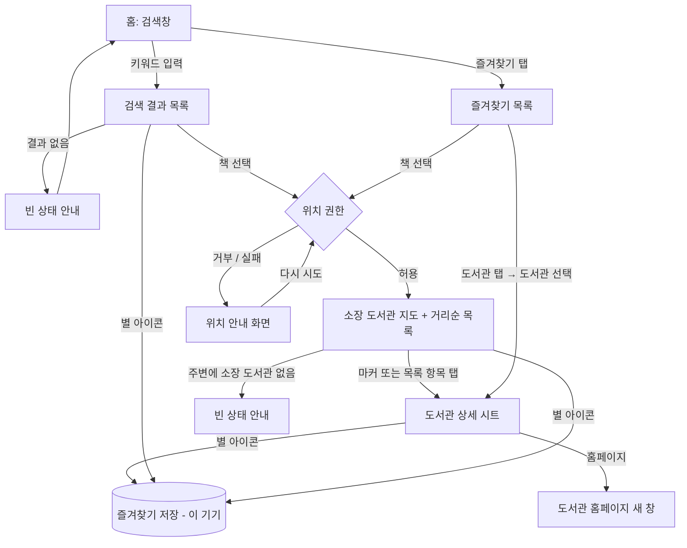

# billim-app 기획서

> 이 문서는 **무엇을, 왜** 만드는지 적는다. 개발 규칙은 `CLAUDE.md`에 있다.
> 기획이 바뀌면 코드보다 먼저 [결정 기록](#9-결정-기록)에 한 줄을 적는다.

## 1. 개요

| 항목 | 내용 |
|---|---|
| 이름 | billim-app |
| 한 줄 소개 | 읽고 싶은 책이 내 주변 공공도서관에 있는지, 대출할 수 있는지 지도에서 한 번에 확인한다 |
| 대상 플랫폼 | 모바일 웹 우선 (휴대폰 브라우저, 세로 화면 기준) |
| 데이터 출처 | 도서관 정보나루 Open API (data4library.kr) |
| 꼭 지킬 제약 | 무료 서비스와 무료 플랜만 쓴다. 과금 API는 쓰지 않는다 |

## 2. 목표

- 도서관 홈페이지를 하나씩 열어 보지 않아도, **가까운 도서관 중 어디에 가면 빌릴 수 있는지** 바로 알 수 있다.
- 밖에서 휴대폰 한 손으로 쓸 수 있을 만큼 단순하다.

## 3. MVP: 이번 버전에서 꼭 되는 것

| # | 기능 | 설명 |
|---|---|---|
| F1 | 책 검색 | 제목이나 저자로 검색하고 결과 목록에서 책 1권을 고른다 |
| F2 | 현재 위치 | 브라우저 위치 권한으로 내 위치를 얻는다 |
| F3 | 소장 도서관 지도 + 거리순 목록 | 고른 책을 가진 주변 도서관을 카카오맵 마커와 거리순 목록으로 함께 보여 준다. 대출 가능 여부에 따라 색이 다르고, 마커와 목록에 같은 순번이 붙는다 |
| F4 | 도서관 상세 | 마커나 목록 항목을 누르면 도서관 이름, 거리, 대출 가능 여부, 주소, 전화, 홈페이지 링크가 보인다 |
| F5 | 즐겨찾기 (책, 도서관) | 책과 도서관을 즐겨찾기에 넣고 뺀다. 즐겨찾기한 책은 바로 주변 도서관 확인으로 간다. 로그인 없이 이 기기에만 저장한다 |

## 4. 이번 버전에서 안 하는 것

새 기능이 이 목록과 부딪히면 먼저 짚고 결정 기록에 남긴다.

- 회원가입과 로그인, 여러 기기 간 즐겨찾기 동기화
- 대출 예약이나 상호대차 신청 (도서관 홈페이지 링크만 제공)
- 도서관 홈페이지 크롤링 (정보나루 API 데이터만 쓴다)
- 인기 도서, 추천 도서, 독서 기록
- 알림 (예: "대출 가능해지면 알려 줘")
- 길찾기 경로 안내
- 네이티브 앱과 앱스토어 배포, PWA 설치
- 데스크톱 전용 레이아웃 (깨지지만 않으면 된다)

## 5. 사용자 흐름



## 6. 화면별 명세

### S1. 홈 (검색)

```
┌─────────────────────────────┐
│ billim                [★ 2] │  ← 즐겨찾기 개수, 누르면 S5
│                             │
│  어떤 책을 빌리고 싶나요?   │
│ ┌─────────────────────┐ ┌─┐ │
│ │ 제목 또는 저자      │ │🔍│ │
│ └─────────────────────┘ └─┘ │
│                             │
│  도서관 정보나루 데이터 기준│
└─────────────────────────────┘
```

- 보이는 것: 검색창, 즐겨찾기 바로가기
- 할 수 있는 것: 키워드 검색 (빈 키워드는 검색하지 않음), 즐겨찾기로 이동
- 빈 상태: 해당 없음

### S2. 검색 결과

```
┌─────────────────────────────┐
│ ← [ 채식주의자          🔍] │
│ 검색 결과 12권              │
│ ┌────┐ 채식주의자        ☆  │
│ │표지│ 한강 · 창비 · 2007   │
│ └────┘                      │
│ ┌────┐ ...               ★  │
│ │표지│                      │
│ └────┘                      │
│        [ 더 보기 ]          │
└─────────────────────────────┘
```

- 보이는 것: 표지, 제목, 저자, 출판사, 출판 연도, 즐겨찾기 별
- 할 수 있는 것: 책 선택 → S3, 별 눌러 즐겨찾기 넣기/빼기, 더 보기
- 빈 상태: "'{키워드}'에 맞는 책을 찾지 못했어요. 제목이나 저자 이름을 바꿔 검색해 보세요."
- 오류: "책 정보를 불러오지 못했어요. 잠시 후 다시 시도해 주세요." + [다시 시도]

### S3. 위치 안내 (권한 거부 또는 위치 실패 시에만)

```
┌─────────────────────────────┐
│ ←                           │
│        📍                   │
│  내 위치를 알아야 가까운    │
│  도서관을 찾을 수 있어요.   │
│                             │
│  브라우저 설정에서 위치     │
│  권한을 허용한 뒤 다시      │
│  시도해 주세요.             │
│      [ 다시 시도 ]          │
└─────────────────────────────┘
```

- 할 수 있는 것: 다시 시도, 뒤로 가기
- 위치 좌표는 저장하지 않는다

### S4. 소장 도서관 지도 + 거리순 목록

```
┌─────────────────────────────┐
│ ← 채식주의자             ☆  │
│ ┌─────────────────────────┐ │
│ │      (2)●               │ │  ● 초록: 대출 가능
│ │            ◉ 나         │ │  ● 회색: 대출 중
│ │  (1)●          (3)●     │ │  ● 노랑: 확인 실패
│ └─────────────────────────┘ │  ← 카카오맵
│ 소장 5곳 · 대출 가능 2곳    │
│ 기준: {데이터 기준 시각}    │
│ ─────────────────────────── │
│ (1) ○○시립도서관  0.8km  ●  │  ← 거리순 목록
│ (2) △△구립도서관  1.2km  ●  │
│ (3) □□작은도서관  2.5km  ●  │
│ ...                         │
└─────────────────────────────┘
```

- 보이는 것: 내 위치, 소장 도서관 마커, 거리순 목록(순번, 이름, 거리, 상태), 요약 한 줄, 데이터 기준 시각. 마커와 목록의 순번은 같다
- 할 수 있는 것: 지도 이동/확대, 마커나 목록 항목 탭 → S4-1, 책 즐겨찾기 토글, 내 위치로 돌아가기
- 정렬: 내 위치에서 직선거리가 가까운 순. 거리가 같으면 대출 가능한 곳이 먼저
- 빈 상태: "주변 도서관에는 이 책이 없어요. 지도를 움직여 다른 지역을 확인해 보세요." *(지도 이동 시 재검색 여부는 미결 사항 Q3)*
- 오류: "도서관 정보를 불러오지 못했어요." + [다시 시도]

### S4-1. 도서관 상세 (아래에서 올라오는 시트)

```
├─────────────────────────────┤
│ (1) ○○시립도서관 0.8km   ☆  │  ← 도서관 즐겨찾기
│ ● 대출 가능                 │
│ 주소: ...                   │
│ 전화: 02-000-0000  [전화]   │
│ [ 도서관 홈페이지 열기 ↗ ]  │
└─────────────────────────────┘
```

### S5. 즐겨찾기

```
┌─────────────────────────────┐
│ ← 즐겨찾기                  │
│ [ 책 (2) ] [ 도서관 (1) ]   │  ← 탭
│ ┌────┐ 채식주의자        ★  │
│ │표지│ 한강                 │
│ └────┘   [ 주변에서 찾기 ]  │
└─────────────────────────────┘
도서관 탭:
│ ○○시립도서관             ★  │
│ 주소 · 전화                 │
```

- 할 수 있는 것: 책 → 주변에서 찾기(S4), 도서관 → 상세 시트(S4-1), 별 눌러 빼기
- 빈 상태 (책): "아직 즐겨찾기한 책이 없어요. 검색 결과에서 ☆를 눌러 저장해 보세요."
- 빈 상태 (도서관): "아직 즐겨찾기한 도서관이 없어요. 도서관 상세에서 ☆를 눌러 저장해 보세요."
- 도서관 탭에서는 특정 책의 대출 가능 여부를 보여 주지 않는다 (책을 고른 뒤 S4에서 확인)
- 안내: "즐겨찾기는 이 기기의 이 브라우저에만 저장돼요."

## 7. "다 됐다"의 기준

공통: `npx tsc --noEmit`, `npm run lint`, `npm test`, `npm run build`가 모두 통과한다.

| 기능 | 완료 기준 | 직접 확인할 것 |
|---|---|---|
| F1 책 검색 | 실제 정보나루 키로 검색 결과가 나온다. 결과 없음과 오류 상태가 보인다. 응답 변환 로직에 테스트가 있다 | 실제 휴대폰에서 한글 키워드 검색 |
| F2 현재 위치 | 허용하면 지도로, 거부하면 S3로 간다. 다시 시도가 동작한다 | 실제 휴대폰(https 배포 주소)에서 허용과 거부를 각각 확인 |
| F3 지도 + 거리순 목록 | 카카오맵에 마커가 뜨고, 목록이 거리순이며, 마커와 목록의 순번이 같다. 거리 계산과 정렬 로직에 테스트가 있다 | 실제 위치에서 목록 1번이 실제로 가장 가까운 도서관인지, 아는 도서관 1곳의 상태가 도서관 홈페이지와 같은지 비교 |
| F4 도서관 상세 | 마커와 목록 항목 모두 시트를 연다. 전화와 홈페이지 링크가 동작한다 | 휴대폰에서 전화 앱이 열리는지 확인 |
| F5 즐겨찾기 | 책과 도서관 모두 넣기/빼기가 새로고침 후에도 유지된다. 저장 로직에 테스트가 있다 | 휴대폰 브라우저를 닫았다 열어도 두 탭이 유지되는지 확인 |

## 8. 외부 API 확인 목록

추측하지 않고 실제 응답으로 확인한 뒤 이 표를 채운다.

| 항목 | 상태 | 확인 결과 |
|---|---|---|
| 정보나루 인증키 발급 | 미확인 | |
| 일일 호출 한도 | 미확인 | |
| `bookExist`가 대출 가능 여부도 주는지, 실시간인지 전날 기준인지 | 미확인 | |
| `libSrchByBook` 응답에 도서관 좌표(위도/경도)가 있는지 | 미확인 | |
| `region` 코드 체계 (위치 → 지역 코드 변환 방법) | 미확인 | |
| `srchBooks` 응답 필드 (표지, ISBN13 포함 여부) | 미확인 | |
| 카카오맵 JavaScript SDK 무료 한도와 키 발급, 도메인 등록 조건 | 미확인 | |

## 9. 결정 기록

| 날짜 | 결정 | 이유 |
|---|---|---|
| 2026-10-27 | 앱 이름은 billim-app | 사용자 결정 |
| 2026-10-27 | 모바일 웹 우선 | 밖에서 휴대폰으로 확인하는 사용 상황이 많다 |
| 2026-10-27 | 데이터는 도서관 정보나루 API만 쓴다 | 무료이고 공공도서관 소장 데이터를 제공한다 |
| 2026-10-27 | 정보나루 API는 서버(Route Handler)를 거쳐 호출한다 | 인증키를 숨겨야 하고, API가 http라서 https 페이지에서 직접 부르면 막힌다 |
| 2026-10-27 | 주변 기준은 현재 위치, 거리순 정렬 | 사용자 결정 |
| 2026-10-27 | ~~MVP는 지도 화면만, 목록 화면은 안 한다~~ → 지도와 거리순 목록을 한 화면에 함께 둔다 | 사용자 정정. 거리순 목록이 필요하다 |
| 2026-10-27 | 즐겨찾기는 로그인 없이 기기(localStorage)에 저장 | 로그인을 안 하는 것에 넣었다. 무료 제약 |
| 2026-10-27 | 즐겨찾기 대상은 책과 도서관 둘 다 | 사용자 결정 |
| 2026-10-27 | 지도는 카카오맵 JavaScript SDK | 사용자 결정. 국내 지도와 지명이 정확하고 무료다 |
| 2026-10-27 | 무료 서비스와 무료 플랜만 사용 | 사용자 제약 |
| 2026-10-27 | Next.js 16 (App Router, `src/`) + TypeScript + Tailwind CSS 4, 테스트는 Vitest 5 | create-next-app 기본 구성. Route Handler로 정보나루 키를 숨길 수 있다 |
| 2026-10-27 | Node 24 LTS (`.nvmrc`, `engines`) | 사용자 결정. Vitest 5가 Node 22.12 이상을 요구한다 |

## 10. 미결 사항

- **Q3. 지도를 움직이면 그 지역으로 다시 검색할지**: API 호출 수와 관련되므로 한도 확인 후 결정
- **Q4. 위치 → 지역 코드 변환 방법**: 정보나루 응답을 확인한 뒤 결정
- **Q5. 배포처**: Vercel 무료(Hobby) 플랜을 후보로 둔다
